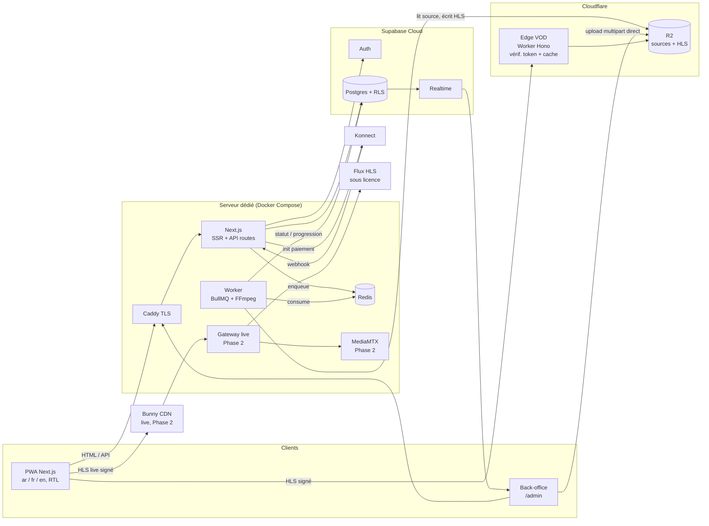
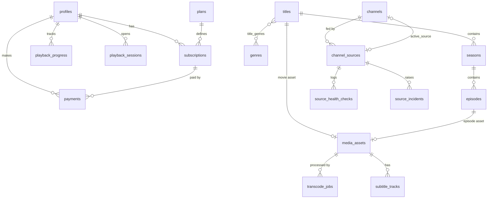
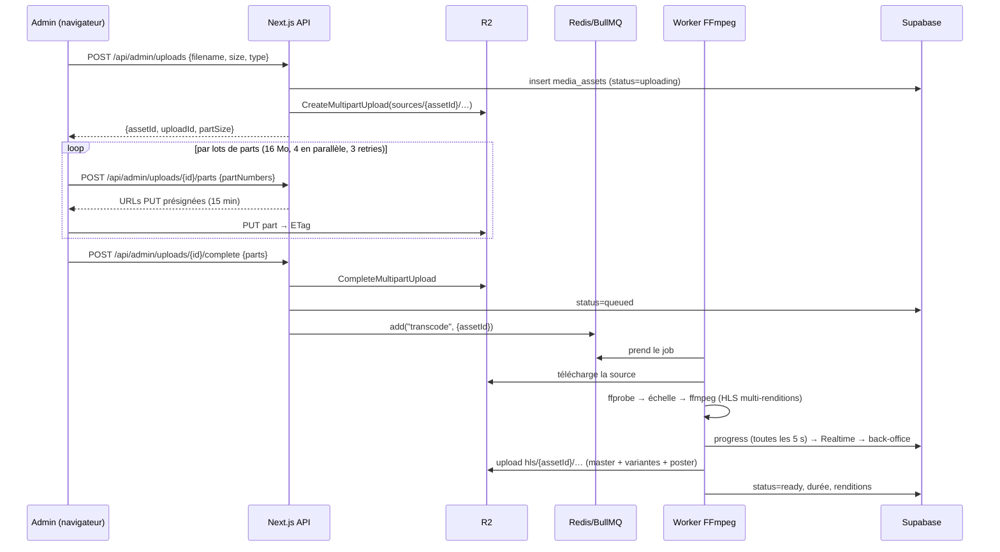
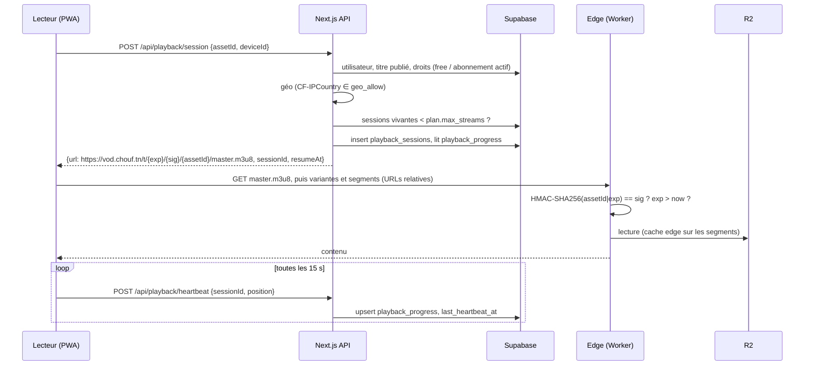
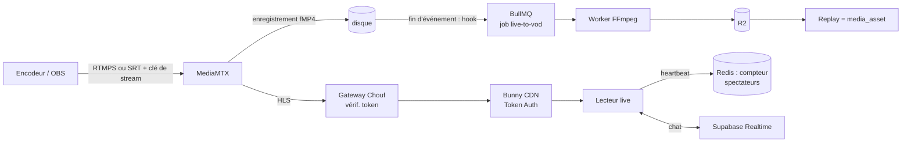
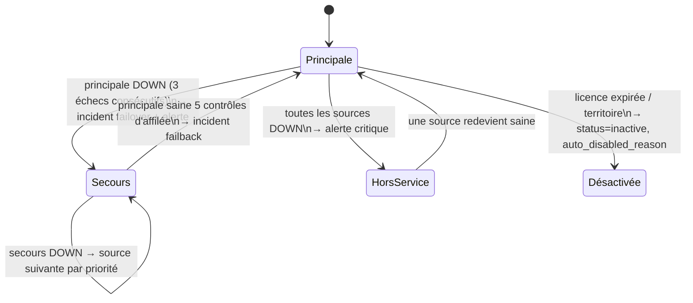

# Chouf (شوف) — Document d'architecture

> Version 1.0 — octobre 2026. Plateforme de streaming VOD + live pour le Maghreb (Tunisie d'abord).

## 0. Hypothèses retenues

Les questions de cadrage ont été tranchées avec les valeurs par défaut suivantes. Chacune est isolée derrière une
abstraction pour pouvoir être changée sans refonte.

| Sujet | Hypothèse | Où c'est isolé |
|---|---|---|
| Marché | Tunisie d'abord, puis Maroc / Algérie | `channel_sources.license_info.territories`, `titles.geo_allow` |
| Paiement | **Konnect** (carte locale, e-DINAR, wallet) ; Stripe plus tard via une entité étrangère | interface `PaymentProvider` (`apps/web/src/server/payments`) |
| Modèle | Freemium sans pub : contenus `free` + contenus `subscriber` ; offres mensuelle et annuelle prépayées ; 2 flux simultanés | tables `plans`, `subscriptions`, `playback_sessions` |
| Volume | 200 h au lancement, +30 h/mois, sources MP4/MOV ≤ 1080p ; sous-titres WebVTT et multi-audio prévus | `media_assets`, `subtitle_tracks` |
| Hébergement | Supabase Cloud (Pro) + **1 serveur dédié Hetzner** (Docker Compose) + Cloudflare R2 | `docker-compose.yml`, variables d'environnement |
| Live | Restreaming des flux sous licence via **notre** origine ; HLS classique (latence 15–30 s) ; pic de 500 spectateurs | `apps/gateway` (Phase 2) |

## 1. Vue d'ensemble



**Principe directeur :** un seul serveur à administrer, aucune vidéo ne transite par le serveur applicatif, la base
est la source de vérité (RLS), et tout ce qui coûte cher en bande passante passe par un CDN.

## 2. Choix technologiques (et ce que je challenge)

| Brique | Choix | Justification |
|---|---|---|
| Frontend | **Next.js 16 (App Router) + TypeScript + Tailwind 4** | SSR pour le SEO du catalogue, API routes pour la logique serveur (évite un backend séparé), `next-intl` pour ar/fr/en avec `dir="rtl"` natif. Déployé en mode `standalone` dans Docker (pas Vercel : coût et proximité Redis). |
| Lecteur | **hls.js** (pas Video.js) | ~70 Ko, contrôle total de l'UI (RTL, reprise, sélection qualité), Safari/iOS lisent le HLS nativement. Video.js ajoute du poids pour des fonctions qu'on refait de toute façon. |
| Backend / Auth / DB | **Supabase** | Auth e-mail + OAuth, Postgres managé, RLS, Realtime pour le suivi du transcodage. Offre Pro (25 $/mois) dès la prod : l'offre gratuite se met en pause. |
| Upload | **S3 multipart présigné, direct vers R2** (challenge de tus) | Le navigateur envoie les morceaux directement dans R2 : pas de serveur tusd, pas de double transfert, pas de disque tampon. La reprise est gérée côté client (parts déjà envoyées réutilisées). tus n'apporterait que la reprise inter-sessions, peu utile pour un seul admin. |
| File de jobs | **BullMQ + Redis** (conservé) | Retries, backoff, progression, concurrence contrôlée. Redis servira aussi au compteur de spectateurs et au rate limiting en Phase 2. |
| Transcodage | **FFmpeg (libx264 + AAC), un seul passage multi-sorties** | Un décodage pour toutes les renditions (240p→1080p), GOP aligné de 2 s, segments HLS de 6 s, `master.m3u8`. Échelle limitée à la résolution de la source. CPU sur serveur dédié : beaucoup moins cher que du GPU cloud à ce volume. |
| Stockage | **Cloudflare R2** | 0,015 $/Go/mois et **aucun frais de sortie**. Sources conservées en classe *Infrequent Access*. |
| CDN VOD | **Cloudflare Worker devant R2** (challenge de Bunny pour la VOD) | Les CGU Cloudflare autorisent la vidéo servie depuis R2 via la plateforme développeur. Coût ≈ requêtes Worker (0,30 $/M) au lieu de 0,005–0,01 $/Go : à 10 000 utilisateurs, ~40 $ contre ~800–1 600 $. Le token est vérifié en périphérie. **Risque** : Cloudflare peut pousser vers un contrat Enterprise à très fort volume, d'où l'interface `CdnSigner` permettant de basculer sur Bunny (Token Auth) sans toucher au client. |
| CDN live | **Bunny CDN** (Phase 2) | Le live est servi depuis notre origine (pas R2) : Cloudflare l'interdirait hors Enterprise. Bunny : Token Authentication, ~0,005–0,01 $/Go, PoP européens proches de Tunis (désactiver les zones Afrique/Asie, facturées plus cher). |
| Live | **MediaMTX** (Phase 2) | Binaire Go unique, ingestion RTMPS/SRT/WebRTC, sortie HLS/LL-HLS, enregistrement fMP4 pour le replay, API HTTP + hooks. SRS est plus lourd ; OvenMediaEngine excelle en WebRTC basse latence, qu'on ne vise pas encore. |
| Reverse proxy | **Caddy** | TLS automatique, config de 15 lignes. Le domaine web passe derrière Cloudflare (proxy HTML uniquement). |
| Paiement | **Konnect** (+ Stripe optionnel) | Stripe n'accepte pas de marchands établis en Tunisie. Konnect n'a pas de prélèvement récurrent par carte : on vend des **périodes prépayées**, chaque paiement réussi prolonge `current_period_end` ; rappel e-mail avant expiration. |
| Tests | **Vitest** (unitaires), **pgTAP** (RLS), Playwright (e2e, plus tard) | La logique critique (signature, droits, échelle FFmpeg, bascule de sources) est en fonctions pures testées. |
| Monorepo | **pnpm workspaces** | `apps/web`, `apps/worker`, `apps/edge`, `packages/shared`. Pas de Turborepo : inutile à cette taille. |

## 3. Structure du dépôt

```
.
├── apps/
│   ├── web/            Next.js : site viewer, back-office /admin, API routes
│   ├── worker/         Workers BullMQ : transcodage FFmpeg, tâches planifiées
│   └── edge/           Passerelle VOD (Hono) : Cloudflare Worker en prod, Node en dev
├── packages/
│   └── shared/         Types DB, schémas zod, signature des URLs, droits, échelle FFmpeg, logique de bascule
├── supabase/
│   ├── migrations/     Schéma SQL + RLS (source de vérité)
│   ├── tests/          Tests pgTAP des politiques RLS
│   └── seed.sql        Données de démo
├── docker-compose.yml  Prod : web, worker, redis, caddy (+ gateway/mediamtx en Phase 2)
├── docker-compose.dev.yml  Dev : + MinIO (R2 local) + edge en Node
└── docs/
```

## 4. Schéma de la base de données



### 4.1 Tables

**Identité et rôles**
- `profiles` — `id` (= `auth.users.id`), `display_name`, `locale` (`ar|fr|en`), `role` (`viewer|admin`), `country`, timestamps. Créé par trigger à l'inscription. Un trigger empêche un non-admin de modifier `role`.

**Catalogue**
- `titles` — `kind` (`movie|series`), `slug` unique, `name`/`synopsis` en `jsonb` `{ar, fr, en}`, `release_year`, `maturity_rating`, `poster_path`, `backdrop_path`, `access` (`free|subscriber`), `status` (`draft|published|archived`), `geo_allow text[]` (vide = monde entier), `asset_id` (films), `search_text` (colonne générée, index trigram).
- `genres`, `title_genres` — classification.
- `seasons` — `title_id`, `number`, `name jsonb`.
- `episodes` — `season_id`, `number`, `name`, `synopsis`, `asset_id`, `access` (nullable : hérite du titre).

**Médias**
- `media_assets` — `status` (`uploading|uploaded|queued|processing|ready|failed`), `source_key`, `upload_id` (multipart S3), `hls_prefix`, `duration_seconds`, `width`, `height`, `renditions jsonb`, `progress` (0–100), `error`.
- `transcode_jobs` — historique par tentative : `asset_id`, `queue_job_id`, `status`, `attempt`, `started_at`, `finished_at`, `log`.
- `subtitle_tracks` — `asset_id`, `lang`, `label`, `path` (WebVTT).

**Lecture**
- `playback_progress` — PK (`user_id`, `asset_id`), `title_id`, `episode_id`, `position_seconds`, `duration_seconds`, `completed`. Alimente « Continuer à regarder ».
- `playback_sessions` — `user_id`, `asset_id` ou `channel_id`, `device_id`, `country`, `started_at`, `last_heartbeat_at`, `ended_at`. Sert à limiter les flux simultanés (session vivante = heartbeat < 60 s).

**Abonnement**
- `plans` — `code`, `name jsonb`, `price_millimes` (1 TND = 1 000 millimes), `currency`, `interval` (`month|year`), `max_streams`, `active`.
- `subscriptions` — `user_id`, `plan_id`, `status` (`pending|active|expired|canceled`), `current_period_start`, `current_period_end`, `provider`.
- `payments` — `user_id`, `subscription_id`, `plan_id`, `provider`, `provider_ref` (unique : idempotence du webhook), `amount_millimes`, `status` (`pending|succeeded|failed`), `raw jsonb`.

**Chaînes (schéma livré en Phase 1, exploité en Phase 2)**
- `channels` — `slug`, `name jsonb`, `logo_path`, `category`, `country`, `language`, `status` (`active|inactive`), `access` (`free|subscriber`), `active_source_id`, `auto_disabled_reason`.
- `channel_sources` — `channel_id`, `label`, `kind` (`external_hls|internal_ingest`), `url` (**jamais lisible par un viewer**), `priority` (1 = principale), `enabled`, `health` (`unknown|healthy|degraded|down`), `consecutive_failures`, `consecutive_successes`, `last_checked_at`, et **`license_info jsonb NOT NULL`** contrôlé par contrainte `CHECK` :
  ```json
  { "holder": "Télévision Tunisienne", "agreement_ref": "TT-2026-014",
    "expires_at": "2027-06-30", "territories": ["TN", "FR"], "notes": "…" }
  ```
- `source_health_checks` — `source_id`, `checked_at`, `ok`, `http_status`, `latency_ms`, `bitrate_kbps`, `error` (rétention 30 jours).
- `source_incidents` — `source_id`, `channel_id`, `kind` (`down|degraded|failover|failback|license_expired`), `started_at`, `resolved_at`, `details jsonb`.

### 4.2 Row Level Security

- RLS activée sur **toutes** les tables ; fonction `public.is_admin()` (`SECURITY DEFINER`, `search_path` figé).
- Catalogue (`titles`, `seasons`, `episodes`, `genres`, `channels`, `plans`) : lecture publique **des lignes publiées/actives** ; écriture admin.
- `media_assets`, `transcode_jobs` : admin uniquement (le viewer n'en a jamais besoin : l'URL de lecture est fabriquée par le serveur).
- `playback_progress` : chaque utilisateur lit/écrit **ses** lignes (`user_id = auth.uid()`).
- `subscriptions`, `payments`, `playback_sessions` : lecture de ses propres lignes ; **écriture réservée au serveur** (clé `service_role`), jamais au client.
- `channel_sources`, `source_health_checks`, `source_incidents` : admin uniquement. Aucune URL source ne quitte la base vers un viewer.
- Les écritures sensibles (prolonger un abonnement) passent par des fonctions SQL transactionnelles (`apply_successful_payment`) appelées avec la clé service.

## 5. Flux principaux

### 5.1 Upload et transcodage



Échelle (plafonnée à la hauteur de la source) :

| Rendition | Résolution | Vidéo | Audio |
|---|---|---|---|
| 240p | 426×240 | 400 kb/s | 64 kb/s |
| 360p | 640×360 | 800 kb/s | 96 kb/s |
| 480p | 854×480 | 1 400 kb/s | 128 kb/s |
| 720p | 1280×720 | 2 800 kb/s | 128 kb/s |
| 1080p | 1920×1080 | 5 000 kb/s | 128 kb/s |

En cas d'échec : 3 tentatives avec backoff exponentiel, puis `status=failed` et l'erreur visible dans le back-office (bouton « relancer »).

### 5.2 Lecture sécurisée (URLs signées)



**Astuce clé :** le token est **dans le chemin** (`/t/{exp}/{sig}/{assetId}/…`). Les playlists HLS utilisant des URLs
relatives, variantes et segments héritent automatiquement du token, sans réécrire les manifestes. La signature couvre
l'`assetId` : un token ne donne accès qu'à une seule vidéo, pour une durée limitée (durée de la vidéo + 2 h, renouvelé
au besoin). La logique de signature est dans `packages/shared` (WebCrypto) et partagée entre Next.js et l'edge.

### 5.3 Abonnement et paiement

```mermaid
sequenceDiagram
  participant U as Utilisateur
  participant W as Next.js API
  participant D as Supabase
  participant K as Konnect

  U->>W: POST /api/payments/checkout {planCode}
  W->>D: insert payments (pending)
  W->>K: init-payment {amount, orderId=paymentId, webhook}
  K-->>W: {payUrl, paymentRef}
  W->>D: payments.provider_ref = paymentRef
  W-->>U: redirection payUrl
  U->>K: paie (carte, e-DINAR, wallet)
  K->>W: GET /api/payments/konnect/webhook?payment_ref=…
  W->>K: GET /payments/{paymentRef} (on ne fait jamais confiance au webhook seul)
  W->>D: rpc apply_successful_payment(paymentId) — idempotent, transactionnel
  D->>D: payments=succeeded ; subscription.period_end = max(now, period_end) + intervalle
  K-->>U: redirection /account?status=success
```

Un job planifié marque `expired` les abonnements dont `current_period_end` est dépassé (la vérification des droits
lit de toute façon `current_period_end`, donc pas de fenêtre d'accès indue).

### 5.4 Live événementiel (Phase 2)



- Clé de stream par événement, ingestion autorisée via le hook d'authentification HTTP de MediaMTX.
- Compteur de spectateurs : `ZADD` des heartbeats dans Redis, comptage glissant sur 30 s, diffusé toutes les 5 s.
- Chat : Supabase Realtime (broadcast), modération admin, rate limiting par utilisateur.

### 5.5 Sources de chaînes : supervision et bascule (schéma en Phase 1, implémentation en Phase 2)



- **Contrôle** (toutes les 30 s par source, worker `source-monitor`) : GET de la playlist (timeout 5 s, mesure de
  latence), vérification `#EXTM3U`, choix de la variante, téléchargement du dernier segment pour mesurer le débit,
  vérification que la playlist avance (live figé = `degraded`). Résultat écrit dans `source_health_checks`.
- **Hystérésis** : 3 échecs → `down`, 5 succès → `healthy`, pour éviter le *flapping*. Toute la décision est une
  fonction pure `decideActiveSource(sources, now)` testée unitairement.
- **Alertes** : webhook générique (Telegram, Discord ou Slack) + e-mail, avec déduplication par incident ouvert.
- **Licences** : job quotidien. Expiration dans moins de 30 jours → alerte ; expirée → source désactivée ; plus
  aucune source valide → chaîne `inactive`. Le géo-blocage utilise l'intersection pays de l'utilisateur ∩
  `territories` de la source active.
- **Jamais d'exposition directe** : le client reçoit `https://live.chouf.tn/c/{exp}/{sig}/{channelId}/index.m3u8`. La
  gateway récupère la playlist de la source active, **réécrit** chaque URI en URL locale opaque (URL amont chiffrée
  AES-GCM), et relaie les segments. Bunny met les segments en cache (clé de cache sans le token), donc l'origine ne
  sert chaque segment qu'une fois par PoP. Une bascule est transparente pour le lecteur.

## 6. Sécurité

- **Auth** : Supabase Auth (e-mail + mot de passe, confirmation e-mail), cookies httpOnly via `@supabase/ssr`.
- **Rôles** : `viewer` par défaut ; `admin` attribué en SQL uniquement. Le `proxy.ts` de Next.js protège `/admin` ; chaque API admin revérifie `is_admin` côté serveur (défense en profondeur), et la RLS est la dernière barrière.
- **Validation** : toutes les entrées d'API passent par des schémas zod (`packages/shared/src/schemas`).
- **Secrets** : clé `service_role`, secret HMAC, clés R2 et Konnect uniquement côté serveur (variables d'environnement, jamais `NEXT_PUBLIC_*`).
- **Contenu** : URLs signées à durée limitée, par asset ; limite de flux simultanés ; géo-blocage ; CORS de l'edge restreint au domaine Chouf. DRM (Widevine/FairPlay) en Phase 3.
- **Paiement** : statut vérifié auprès de Konnect, jamais déduit du webhook ; traitement idempotent (`provider_ref` unique).
- **En-têtes** : CSP, HSTS, `X-Frame-Options` via Next.js ; rate limiting des routes d'auth et de paiement (Redis).

## 7. Estimation des coûts mensuels

### Hypothèses
- Consommation : **15 h de VOD par utilisateur actif et par mois**, débit moyen ABR ≈ 2,5 Mb/s ≈ **1,1 Go/h**.
- Catalogue : 200 h (palier 100), 400 h (palier 1 000), 1 000 h (palier 10 000). HLS ≈ 5 Go/h toutes renditions ; source ≈ 8 Go/h.
- Live (Phase 2) : 5 h de chaînes et 2 h d'événements par utilisateur et par mois.
- Prix publics constatés fin 2025, en USD, **à revérifier** avant engagement ; 1 € ≈ 1,08 $.

| Poste | 100 utilisateurs | 1 000 utilisateurs | 10 000 utilisateurs |
|---|---|---|---|
| Visionnage VOD | 1,65 To | 16,5 To | 165 To |
| **Stockage** R2 (HLS 0,015 $/Go + sources IA 0,01 $/Go) | 31 $ | 62 $ | 155 $ |
| **Transcodage** (serveur dédié Hetzner ~50 €, partagé avec web/Redis) | 55 $ | 55 $ | 110 $ (2ᵉ serveur) |
| **CDN VOD** (Worker + opérations R2) | 0–5 $ | 5 $ | ~40 $ |
| *Alternative CDN VOD Bunny (0,005–0,01 $/Go)* | *8–17 $* | *83–165 $* | *825–1 650 $* |
| Supabase (Pro + compute) | 25 $ | 25 $ | 85 $ |
| E-mail transactionnel, domaine, divers | 2 $ | 5 $ | 25 $ |
| **Sous-total Phase 1 (VOD)** | **~115 $** | **~150 $** | **~415 $** |
| **Live** Bunny (chaînes + événements, 0,005–0,01 $/Go) | 4–8 $ | 40–80 $ | 400–800 $ |
| **Total avec live** | **~120 $** | **~190–230 $** | **~815–1 215 $** |
| Frais de paiement Konnect | % du chiffre d'affaires (à négocier) | | |

Leviers d'économie : supprimer les sources après transcodage (−50 % de stockage), plafonner la qualité mobile à 720p,
servir le live depuis le volume network de Bunny et désactiver les zones de facturation chères.

**Lecture :** le poste qui explose avec l'audience est la bande passante. Le choix R2 + Worker pour la VOD est la
décision qui pèse le plus sur le budget ; c'est pour ça que la signature est abstraite (`CdnSigner`).

## 8. Déploiement

- **Prod** : un serveur Ubuntu avec Docker. `docker compose up -d` lance `caddy`, `web`, `worker` et `redis` (+ `gateway` et `mediamtx` en Phase 2). L'edge VOD se déploie sur Cloudflare avec `wrangler deploy`. Migrations : `supabase db push`.
- **Dev** : `docker compose -f docker-compose.yml -f docker-compose.dev.yml up` ajoute MinIO (R2 local) et l'edge en mode Node. Supabase local via `supabase start`.
- **CI** (GitHub Actions) : lint, typecheck, tests Vitest, tests pgTAP sur un Postgres éphémère, build des images.
- **Observabilité** : logs JSON (pino), Sentry (offre gratuite), Uptime Kuma pour la disponibilité, tableau de bord des jobs dans le back-office.

## 9. Évolutions prévues (Phase 3)

Chaînes 24/7 avec EPG (table `epg_programs`), apps TV (Expo / React Native TV), DRM multi-clé via un service
(EZDRM, PallyCon) avec un packager CMAF (Shaka Packager), recommandations (pgvector), téléchargement hors-ligne
(nécessite le DRM), profils multiples (table `viewer_profiles`, qui touchera `playback_progress`).
